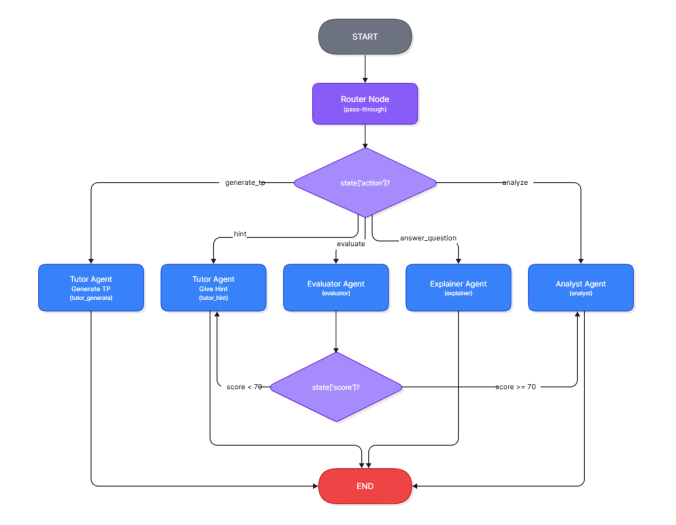

# LearnLab AI
### Turn a programming attempt into a next step the student can understand.

During a programming lab, students need help at different moments: understanding an exercise, diagnosing an error, or deciding what to try next. LearnLab AI connects course material, an interactive code editor, execution, and AI feedback in one workspace. A teacher creates a topic and uploads course documents; a student joins with an invitation code, generates a tailored exercise, runs code, and submits a solution for feedback.

**For the teacher**, the same activity becomes visible through generated exercises, submitted code, scores, recurring error categories, class analytics, and student reports. This gives a concrete basis for choosing what to explain again in the next session.

A collaborative **PFA project — FST Mohammedia, IDSI, 2025/2026**.

## From a submission to useful feedback

Consider a student working on a Python exercise from a teacher's topic. They run an attempt, inspect the console output, revise the code, then click **Submit**. The system returns a score, output-check results, categorized errors, and feedback; a lower-scoring submission also receives a progressive hint.

Three choices make that feedback path inspectable:

- **Explicit agent decisions.** A shared LangGraph state carries the exercise, student profile, submitted code, execution outputs, and requested action. Dedicated tutor, evaluator, explainer, and analyst nodes handle different learning needs.
- **Course context scoped to the teacher.** Documents are indexed in a separate Qdrant collection per teacher. Retrieval can filter by topic and removes duplicate passages before the tutor or explainer uses them. This ties exercise generation and explanations to the course being taught.
- **Practice and assessment stay distinct.** A Run attempt stores execution output and a qualitative analysis without a score. Submit invokes the scored evaluation path. Teachers can interpret practice attempts as part of learning rather than treating every run as a final assessment.

[](docs/images/schema_learnlab.png)

*Click the diagram to open it at full size. It shows agent control flow; storage, retrieval, and code execution support this graph outside the picture.*

### Read the diagram through one submission

1. **Execute and build context.** The [student API](backend/app/routers/student.py) sends the submitted code to Piston and records `stdout`, `stderr`, and the exit code. It saves a submission, then builds the shared state with the exercise, expected outputs, student level, weak points, and `action="evaluate"`.
2. **Route to the evaluator.** The router uses `state["action"]` to choose the next node. The [evaluator](backend/ai_engine/agents/evaluator.py) classifies some errors from the execution result and compares the captured output with expected outputs. It asks the LLM to assess code quality using the statement, code, outputs, and precomputed checks.
3. **Combine the evidence.** When expected-output checks are present, their pass rate contributes up to 40 points and the LLM quality score contributes up to 60. Without those checks, the evaluator uses the LLM score. The public implementation compares one captured execution output against the stored expected outputs; it does not run each test input separately.
4. **Choose the next learning step.** Below 70, the [graph](backend/ai_engine/graph.py) calls the tutor's hint node. Redis tracks the hint level, and the tutor uses the exercise, expected outputs, submitted code, detected error type, and retrieved course passages to give progressively more specific guidance. At 70 or above, the analyst updates the profile using recent scored submissions and recurring errors.
5. **Return and retain the result.** The API saves the score and feedback in PostgreSQL and returns the evaluation to the interface. The teacher can revisit the submitted code and results rather than seeing only an isolated grade.

The other branches serve different moments: `generate_tp` asks the tutor to create a statement, starter code, checks, and hints using course retrieval and the student profile; `answer_question` asks the explainer for a contextual answer; `hint` requests the next hint; `analyze` invokes the profile analyst.

## What the teacher can follow

The [teacher API](backend/app/routers/teacher.py) exposes enrolled students, their submissions, generated exercises, and class analytics. Teachers can request an AI report or ask a question about a student's progress. Report prompts include submitted code, scores, execution attempts, and error patterns, so recommendations can refer to actual work.

[Scheduled reports](backend/app/main.py) are also generated for active student/teacher pairs. The [analyst](backend/ai_engine/agents/analyst.py) persists the report and summary metrics; this report path is separate from the post-evaluation profile-update node shown in the diagram.

## Explore and run the public implementation

The public code includes the React interface, FastAPI routes, four agent implementations, RAG indexing/retrieval, database migrations, and Docker Compose resources. A useful local walkthrough is: create a teacher, add a topic and course document, register a student through an invitation, generate an exercise, then compare **Run**, **Submit**, **Hint**, and the teacher's submission view.

| Component | Role in that walkthrough |
| --- | --- |
| React and Monaco | Exercise workspace, code editing, results, and teacher views |
| FastAPI and WebSocket | Authenticated actions and streamed chat responses |
| LangGraph | Visible action-based routing and score-dependent follow-up |
| Qdrant and MinIO | Searchable course passages and the uploaded source files |
| PostgreSQL and Redis | Learning records, profiles, reports, session state, and hint counters |
| Piston | Code execution outside the API process on the normal execution path |

For course grounding, inspect the [indexer](backend/rag_pipeline/indexer.py) and [teacher-scoped retriever](backend/rag_pipeline/retriever.py). For generated guidance, inspect the [tutor](backend/ai_engine/agents/tutor.py) and [explainer](backend/ai_engine/agents/explainer.py).

The public submission helper has a local Python subprocess fallback if Piston fails. Treat that fallback as development behavior, not as a sandbox guarantee. The report describes the broader pedagogical design; the source links above identify the behavior available to inspect and run here.

## Run locally

Prerequisites: Git, Docker with Docker Compose, and your own OpenAI API key. The Piston container uses privileged mode; run this development stack on a machine you control.

```bash
git clone https://github.com/Jabour-Salahddine/learnLab-ai-pub.git
cd learnLab-ai-pub
cp .env.example .env
cp frontend/.env.example frontend/.env
```

Set `OPENAI_API_KEY` and a long random `JWT_SECRET_KEY` in `.env`. Update database and MinIO credentials consistently if you change them. For the Compose frontend, set `FRONTEND_URL=http://localhost:8080` and include `http://localhost:8080` in `CORS_ORIGINS`.

```bash
docker compose up -d
docker compose exec backend alembic upgrade head
```

| Open | Address |
| --- | --- |
| Student and teacher interface | http://localhost:8080 |
| API documentation | http://localhost:8000/docs |
| Qdrant dashboard | http://localhost:6333/dashboard |
| MinIO console | http://localhost:9001 |

Create a teacher account, upload a topic's course documents, then use the generated invitation code to register a student. Code execution requires the corresponding language runtime to be installed in Piston; check its `/api/v2/runtimes` endpoint before a submission.

## Work with the project

| Area | Purpose |
| --- | --- |
| [backend/](backend/) | FastAPI, agents, retrieval, persistence, and migrations |
| [frontend/](frontend/) | React, TypeScript, Monaco editor, and learning dashboards |
| [docker/](docker/) | Container and proxy resources |

```bash
docker compose logs -f backend
docker compose exec backend alembic revision --autogenerate -m "description"
```

## Team and academic context

Built by **Salahddine Jabour and Nawfal Taouqi**, supervised by **Pr. Hanae Sbai**, at **FST Mohammedia, IDSI, 2025/2026**, as a Projet de Fin d’Année (PFA). The team collaborated on agent prompts, workflow validation, and integration. Contributions should explain the affected student or teacher workflow and include relevant checks.
