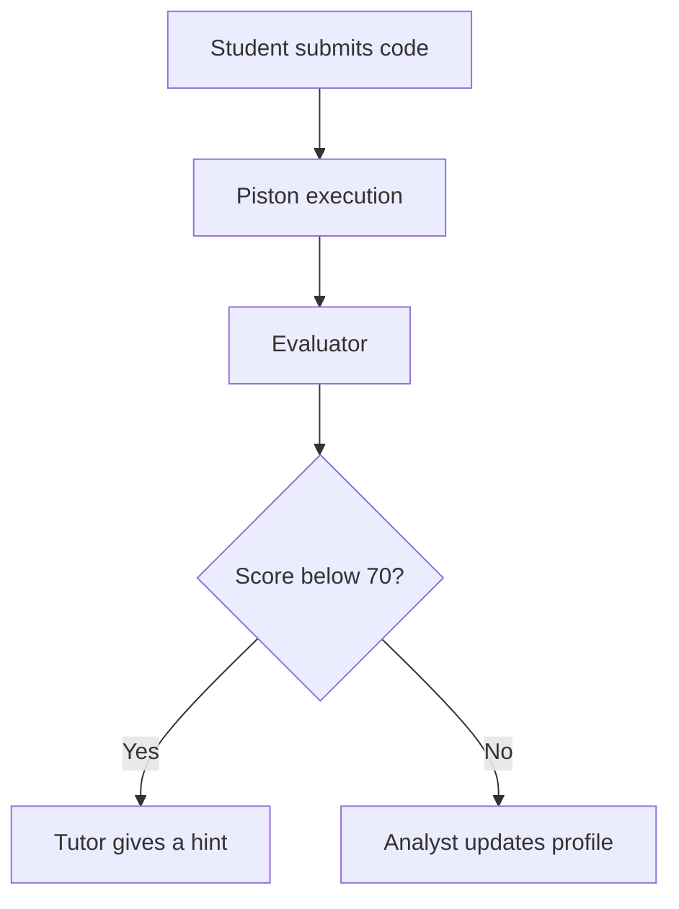

# LearnLab AI
### Practice, get feedback, and understand the next step.

Engineering students need more than a final grade to improve their code. LearnLab AI brings practical exercises, a code editor, execution, and AI guidance into one learning workspace. A teacher uploads course material and shares an invitation code; a student joins, works through a tailored exercise, submits code, and asks for help with the result.

Built as my final-year preparatory project (PFA) at **FST Mohammedia, IDSI, 2025/2026**.

## From a submission to useful feedback

The interesting part is how the system chooses what happens next:

- **Four agents, explicit decisions.** A LangGraph state graph routes exercise generation, questions, hints, and evaluation to dedicated agents. After evaluation, a score below 70 routes to a tutor hint; otherwise, the analyst updates the student profile. This makes the feedback path visible in code instead of hiding it in one large prompt.
- **Course context belongs to the teacher.** Course files are indexed in a separate Qdrant collection for each teacher. Retrieval can filter by topic, removes duplicate passages, and supplies source filenames with the context used by the tutor and explainer.
- **Code runs outside the API process.** The integrated editor sends submissions to a Piston execution service. FastAPI handles REST and WebSocket interactions, PostgreSQL stores learning records, Redis supports session state, and MinIO stores uploaded files.



Explore the [agent graph](backend/ai_engine/graph.py), [teacher-scoped retriever](backend/rag_pipeline/retriever.py), and [student API](backend/app/routers/student.py).

## Run locally

Prerequisites: Git, Docker with Docker Compose, and your own OpenAI API key. The Piston container uses privileged mode; run this development stack on a machine you control.

```bash
git clone https://github.com/Jabour-Salahddine/learnLab-ai-pub.git
cd learnLab-ai-pub
cp .env.example .env
cp frontend/.env.example frontend/.env
```

Set `OPENAI_API_KEY` and a long random `JWT_SECRET_KEY` in `.env`. Update database and MinIO credentials consistently if you change them. For the Compose frontend, set `FRONTEND_URL=http://localhost:8080` and include `http://localhost:8080` in `CORS_ORIGINS`.

```bash
docker compose up -d
docker compose exec backend alembic upgrade head
```

| Open | Address |
| --- | --- |
| Student and teacher interface | http://localhost:8080 |
| API documentation | http://localhost:8000/docs |
| Qdrant dashboard | http://localhost:6333/dashboard |
| MinIO console | http://localhost:9001 |

Create a teacher account, upload a topic's course documents, then use the generated invitation code to register a student. Code execution requires the corresponding language runtime to be installed in Piston; check its `/api/v2/runtimes` endpoint before a submission.

## Work with the project

| Area | Purpose |
| --- | --- |
| [backend/](backend/) | FastAPI, agents, retrieval, persistence, and migrations |
| [frontend/](frontend/) | React, TypeScript, Monaco editor, and learning dashboards |
| [docker/](docker/) | Container and proxy resources |

```bash
docker compose logs -f backend
docker compose exec backend alembic revision --autogenerate -m "description"
```

Academic project — FST Mohammedia, 2025/2026. Contributions should explain the affected student or teacher workflow and include relevant checks.
